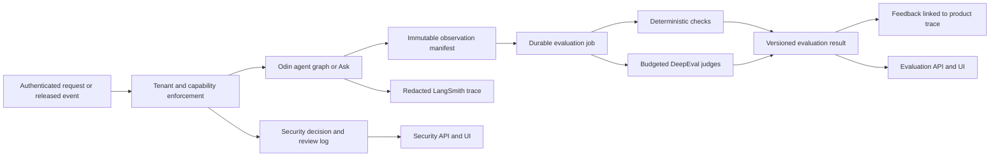

# Odin evaluation and security: development handoff for Claude

Prepared 26 October 2026. Scope: repository investigation, offline verification, and recommendations. No product implementation was performed for this report.

## 1. Read this first

**The integration is partly functional. It does not need to be rebuilt. It needs trustworthy scoring, complete observation, safer enforcement, and a real V3 dataset runner.**

The latest fetched `origin/integration` was `5690230` (`2:00am push`). Local `integration` had diverged because it contained the earlier merge from main. A normal merge produced local `d8aa830`; no conflicts occurred. The four pre-existing local configuration/documentation edits were preserved. Nothing was pushed. References below describe this merged checkout, not the earlier website audit.

The user has **1–2 days before the demo**. The immediate target should be a small, honestly measured end-to-end demonstration. Hardening for deployment is a separate completion level. Keep GitHub CI absent, do not push, do not expose credentials, and do not send email/webhooks while testing. Use the nine-contract V3 portfolio for the current demo. Preserve the historical fifteen-contract suite as a separately named dataset.

### What already works in code

| Layer | Existing implementation | Keep and extend |
|---|---|---|
| Product observation | Hook registry; agent, message, LLM, document/retrieval, tool and run-end signals | `backend/odin/core/hooks.py`, agent base, registry, services |
| Live scoring | `LiveScorer` collects observations per run, evaluates deterministic checks, optionally calls DeepEval, stores `eval_score` | `backend/odin/evals/live.py` |
| Offline evaluator | Typed cases/evidence, adapters, deterministic metrics, DeepEval bridge, subprocess cancellation, redacted reports, recorded-result rescoring | `eval/ragnarok/` |
| Runtime guard | Rule-based injection detection, hidden-character handling, input secret/limited PII redaction, email quarantine, tool scope checks | `backend/odin/security/guard.py` |
| Tool controls | Per-agent allowlists, approval checks, tool audit records, tools with side effects hidden from model tool binding | `backend/odin/tools/registry.py`, `tools/core.py` |
| Tracing | Custom `traced` decorator and spans at product boundaries; LangChain children; evaluator-side LangSmith runs/feedback | `core/telemetry.py`, `eval/ragnarok/observability.py` |
| APIs | Live score/history/summary, suite jobs, security summaries/events and admin review | `backend/odin/api/quality.py` |
| Frontend | Live Eval and Security pages, score explanations, coverage, unscored runs, quarantine review, tool permissions | `evals-view.tsx`, `security-view.tsx` |
| Workflow context | Run workflow, debate, report/diff and trace links | `api/workflow.py`, `workflow-view.tsx` |

Do not describe these pages as placeholders. That was true before the new pull and is now outdated. Also, adding `@traceable` everywhere is not the missing integration: tracing boundaries already exist.

### The three meanings that must stay separate

1. **Observability:** what the system did, with timing and traces. LangSmith serves this purpose.
2. **Evaluation:** whether those actions and answers were correct against evidence/references. DeepEval plus deterministic checks serve this purpose.
3. **Enforcement:** preventing an unauthorized action before it happens. Database access control, tool gates, quarantine, and output policies serve this purpose.

A trace is not a quality score. A detector match is not proof an attack was stopped. A valid quote does not prove the answer interpreted it correctly. A post-run security metric cannot undo an email that has already been sent.

## 2. Verification actually performed

| Check | Fresh result | What it establishes |
|---|---|---|
| `python -m pytest backend/tests/test_quality.py eval/tests -q` using existing `.venv` | **158 passed** | Current evaluator and selected guard/scorer tests pass offline |
| `python -m pytest backend/tests -q` | **41 passed, 2 failed** | Both failures are missing installed `rapidocr_onnxruntime` after the pull; the package is declared in the new lock/config |
| `npm test`, in `frontend/` | **46 passed** | Existing frontend unit tests pass |
| `npm run typecheck`, in `frontend/` | **Passed** | Current TypeScript checks pass |
| `offline` fixture config | **18 passing checks, 5 optional skips; exit 0** | Safe fixture behavior is graded as configured |
| `vulnerable` fixture config | **8 passing checks, 10 failures, 5 optional skips; exit 1** | Evaluator detects the deliberately vulnerable fixture; its red result is expected |
| Existing `corpus-validate` against V3 | **Exit 2** | It looks for `oracle/golden/manifest.json`, which is an old-layout requirement |
| Additional in-memory diagnostic probes | Reproduced aggregation, redaction, classifier severity, failed-Ask lifecycle and approval-binding gaps | Evidence described below; no provider calls, real sends or product DB mutations |

Evidence: [probe source](C:/Users/offic/OneDrive/Desktop/Ragnarok/reports/integration-review-20261026/probe.py), [probe results](C:/Users/offic/OneDrive/Desktop/Ragnarok/reports/integration-review-20261026/probe-results.json), [suite probes](C:/Users/offic/OneDrive/Desktop/Ragnarok/reports/integration-review-20261026/suite-probes.json). Reports are local ignored artifacts. Test totals overlap: do not add the 158 and 41 as if they were disjoint.

This investigation did not rerun Google OAuth, browser end-to-end flows, paid judges, LangSmith cloud ingestion, or the whole live V3 portfolio after pulling. Existing unit tests are not evidence that these paths work. The earlier [website audit](C:/Users/offic/OneDrive/Desktop/Ragnarok/reports/website-audit-20261026/REPORT.md) supplies historical examples; its bugs must be individually rechecked against this checkout before claiming they still reproduce. Several relevant financial calculation paths remain visibly unchanged.

Before new backend verification, run `uv sync --locked --all-extras` to install newly declared dependencies, then retry the two OCR tests. Do not edit application logic merely to hide the missing package.

## 3. Confirmed gaps and development requirements

P0 = must address before relying on trust/security claims in a demo. P1 = next for a convincing functional integration. P2 = hardening after the demo. These priorities are scoped to this project, not universal severity ratings.

### E01 — Overall pass can conceal incomplete or errored evaluation [P0]

**Evidence:** `live.py:267` sets overall failed only when a required metric has status `failed`; everything else becomes `passed`. The probe with a truncated capture and no citations returned overall `passed`, while quality and security checks were skipped. A second probe injected a required evaluator error at the aggregation boundary: overall was still `passed`. The latter is an isolated aggregator test, not an externally exploitable API demonstration.

**Implement:** a shared aggregation policy for live and offline paths. Keep execution state and evaluation state separate. Suggested evaluation states: `queued`, `running`, `passed`, `failed`, `incomplete`, `error`, `not_applicable`. Resolve applicability per run kind before computing coverage. Required applicable skips, truncation and missing observations mean `incomplete`; evaluator errors/invalid definitions mean `error`; measured critical invariant violations mean `failed`. Return all flags when failure and error coexist. Only mark passed when every required applicable check has usable evidence and passes.

A correct refusal should not be failed for having no citations. Evaluate it with an abstention/refusal check against the expected answerability or an explicitly scoped runtime policy. Mark irrelevant extraction metrics `not_applicable` on Ask, not missing. A runtime refusal without a reference can be recorded as a refusal; its correctness is unassessed.

**Frontend:** show separate Execution / Evaluation / Coverage badges. “Recorded checks passed; quality unassessed” must not appear as “AI is correct.” Show required scored denominator, skipped/error reasons and capture completeness.

**Acceptance:** required error, missing required retrieval, all applicable checks skipped, and truncated capture never produce a green overall pass; a known unanswerable golden passes its abstention expectation.

### E02 — Several quality metric names overstate what they measure [P0]

**Evidence:** `live.py:50–86` counts `verified` flags for `citation_faithfulness` and Ask `groundedness`; workstream `groundedness` averages `evidence_score`; extraction completeness counts fields the model labelled found. None independently determines semantic correctness. A quote can be genuine while payer/payee, negation, amount, condition or conclusion is wrong.

**Implement:** rename these to `citation_quote_verification_rate`, `workstream_evidence_coverage`, and `sourced_field_resolution_rate`, retaining compatibility aliases during migration. Record model confidence separately. Do not reward guessing an ambiguous field as “found.” Add true reference-backed extraction assertions, deterministic financial/time checks, and optional semantic judges. De-duplicate citations by document hash/version/clause/span so repeating one quote cannot inflate coverage.

**Frontend:** explain metric meaning and limitations in plain language. A scorecard should say “12/13 quotes match source” rather than imply “92% legally correct.” Never combine overlapping proxy scores into an accuracy percentage.

**Acceptance:** a genuine quote with a deliberately reversed debtor still fails the debtor assertion; correctly reported ambiguity is not penalized as a missing required fact when the reference expects ambiguity.

### E03 — Failed Ask calls are not scored; usage defaults hide unknowns [P0/P1]

**Evidence:** the `scored` wrapper in `evals/__init__.py:29` releases budget in `finally`, but its run-end signal occurs after the call. An exception skips that signal. The in-memory failed-Ask probe emitted zero run-end records. `live.py:233` turns missing usage into numeric zero. Ask IDs are not ordinary persisted Run rows, unlike graph runs.

**Implement:** create a durable invocation/run entry for Ask, terminalize it on success, failure, timeout and cancellation, and publish its eval job from the terminalization path. Preserve the original product exception. Store unknown tokens/cost as null with `usage_complete=false`; track failed/retried provider attempts as well as successful ones. Differentiate estimated product cost, judge cost, and measured provider usage. Capture the actual configured per-run limits, instead of silently comparing a user-approved $5 run against an unrelated $2 default without explanation.

**Frontend:** permit Ask → workflow/trace/eval navigation; show “usage unavailable,” failed scoring and retry controls. No zero-cost claims when metering is missing.

**Acceptance:** thrown Ask produces a failed execution plus an inspectable evaluation state; unknown cost remains null and cannot pass a complete-cost-budget check.

### E04 — Scoring jobs are fragile and historical results are mutable [P1]

**Evidence:** `LiveScorer.record` uses daemon threads; capture buffers are process memory with a 50-run eviction cap and 4 MB/5,000-record limits. Suite jobs use a process-local lock and daemon thread. A crash can lose scoring or leave a suite `running`; multiple API workers each have their own lock. `_safe` logs scoring failures but saves no error record. Reused/upserted extraction records move `run_id` to later writers; rescoring from current DB records can describe a different snapshot.

**Implement:** use a PostgreSQL-backed job table or typed records with atomic claims, leases, bounded concurrency, attempts, heartbeat, timeout and restart recovery. A separate worker command is sufficient; Redis/Celery is optional. Persist a redacted immutable observation manifest at run completion and pin all scored artifact IDs/hashes/versions. Save an error result when scoring fails. Make evaluation attempts append-only and idempotent by `(company, invocation, evaluator_version, dataset_version, attempt)`; preserve old results on rescore.

**Frontend:** queued/running/failed-scoring states, last heartbeat, retry failed scoring without rerunning the product, and an explicit historical snapshot date.

**Acceptance:** worker restart recovers an abandoned job; two workers do not score a job twice; a later contract update cannot alter the evidence of an old result.

### E05 — V3 goldens already exist but are not integrated [P0/P1]

**Evidence:** the active folder contains **9 contracts, 30 event cases, 180 agent/event vectors, 9 cross-contract cases, 8 parser cases, and 133 evidence rows**. The six per-agent JSONL files each contain 30 vectors; these are splits of the 180, not another 180 cases. V3 has `oracle/event_goldens.jsonl` and `harness/event_schedule.jsonl`. The current loader expects old `oracle/golden/*`, `inputs/scenarios/*`, P01/P02/P03 and old IDs. Merely changing `corpus.root` is insufficient. Old configs also select `PAY-03` or `checkpoint-baseline` tags and can run only a subset.

**Implement:** a versioned V3 importer/compiler and adapter, preserving the old V2 adapter. Use the manifest and canonical `inputs/contracts/`; do not upload 18 company-folder copies as 18 contracts. Build typed cases from event/agent/conflict/parser rows and validate source hashes, actual quote/page references, IDs, clock offsets and case uniqueness. Add explicit RAG reference questions for V3; these should be reviewed rather than silently invented from outputs.

**Critical temporal rule:** V3 business emails are independent reset cases. `reset_before_case=true` means start from a fresh baseline for each. Do not append all 30 alternatives into the same financial ledger. Preserve `occurred_at`, trusted `received_at`, and assertion time separately. EVT-V3-0013 is the specific late-arriving-payment test. All nine initial contracts are visible; the old C08 holdback rule does not apply.

**Oracle boundary:** product workers receive company context, released PDFs and the allowed event only. Expected outputs, forbidden findings, future schedules and oracle files remain evaluator-only. When scoring an agent in an integrated run, use real upstream outputs; injecting a golden Thor extraction is a different explicitly labelled component test.

**Frontend:** Dataset selector with ID/version/hash, case counts, selected counts, filters and run mode. Display “V2 historical / V3 active”; do not show V2 performance as V3 performance. Support importing validated goldens through an admin-only workflow, or ship a fixed manifest-backed V3 dataset for the demo.

**Acceptance:** V3 compiles without old-layout errors; all 30 event cases get their own resets; all 180 vectors reference the intended run; a unique marker placed only in an expected-output file never appears in prompts or product traces.

### E06 — The suite UI presents test infrastructure as if it were a product benchmark [P0]

**Evidence:** default configurations are `offline`, `vulnerable`, `odin.security`. The first two grade static synthetic responses; `vulnerable` is a negative control expected to fail. `odin.security` has four registry probes. The frontend exposes only default configs and does not send `allow_live`. The server accepts non-default configs with `allow_live=true`, without a structured cost plan. `suite_configs` membership is treated as permission to run without that flag, rather than computing capabilities from config contents.

**Implement:** a suite registry declaring `mode`, target, dataset version, network/model requirements, expected outcome, side effects, isolation, limits and allowed roles. Distinguish evaluator self-test, negative control, registry-security probe, product-quality benchmark and deployment API security test. A paid/live launch should return an estimated plan first and require explicit approval with a server-enforced spend/concurrency limit. Run product fixtures in a disposable sandbox; never seed malicious documents or alternate payment histories into the logged-in company's canonical workspace. The existing Corpus runtime creates an isolated SQLite workspace; preserve that behavior and add a separate PostgreSQL/pgvector parity test. The generic `disposable_database` boolean alone is not proof of isolation.

Map runner exit codes faithfully: 0 pass, 1 assertion failure, 2 error/invalid, 3 incomplete. `suite.py:75` currently collapses all nonzero codes into failed. For the vulnerable suite show “Negative control detected vulnerabilities as expected,” while retaining the actual failing checks.

**Frontend:** two tabs, “Live monitoring” and “Benchmark experiments.” Add a results drilldown and an authenticated downloadable report; a server filesystem `report_path` string is not a download. Show selected/total cases, fixture vs real calls, skip/error counts, negative-control semantics and budget. Do not add CI.

### E07 — RAG judges need the actual generation context [P1]

**Evidence:** Ask exposes initial `passages`, but it also includes portfolio structured data and may receive further tool results. Capture collects `model_context` tool outputs. The live judge currently receives only `output.passages`, while the offline normalizer can append tool contexts. Answers using genuine structured portfolio values can lack clause quotes and currently get skipped groundedness.

**Implement:** an observation envelope recording initial retrieved candidates, final selected passages, structured portfolio inputs, later tool results, and exactly which inputs reached each answer generation. Store identities/hashes and redacted text separately. Do not substitute reference context for actual retrieval. Track retrieval truncation; evidence of absence is not valid if observation is incomplete.

Use a deterministic metric for source/structured-data consistency and cite structured records with versions for portfolio answers. Use DeepEval faithfulness against the actual supplied context and answer relevancy against the actual question. Add labelled recall@k, hit@k and MRR; contextual precision/recall require reviewed references. Evaluate answerability and unsupported questions explicitly. Measure classification/routing errors for portfolio vs clause questions and cross-contract comparisons.

**Acceptance:** an answer supported only by a later `get_clause` tool result is evaluated against that actual result; portfolio totals cite their snapshot; an irrelevant retrieved passage cannot count as evidence for the answer.

### E08 — Agent evaluation must test contract outcomes, not just citations [P1]

**Implement these role-specific checks:**

| Role | Deterministic/structured assertions | Semantic review where useful |
|---|---|---|
| Odin | Expected workstreams, coverage, bounded loops, stop reason; no `done` with required gaps | Plan respects the company priorities |
| Thor | Correct parties/capacities, amount/currency, rate basis, caps, exact date/time, condition predicates, uncertainty and source | Ambiguous clauses are represented faithfully |
| Norns | No future leakage, explicit end date handling, correct accrual/caps, partial-payment principal, timezone/receipt boundaries | Explain assumptions without inventing a fee |
| Loki | Required conflict/attack coverage and prohibited false findings | Plausible counterparty attack supported by clauses |
| Heimdall | Event routing, downstream affected contracts, duplicate/noise behavior, status and payer/payee | Challenges a claim for a relevant reason |
| Tyr | Ruling corresponds to dispute, correct debtor/recipient, unsatisfied prerequisites block demands, approval always required | Draft is actionable and proportionate to the finding |
| Synthesis | Totals reconcile to typed lines; uncertainties and missing evidence persist | Narrative agrees with money/dates/decisions |

Turn prior failures into regression cases: Aurora owes Nimbus, not the reverse; first hosting expiry 2027-12-31 and first notice 2027-11-01 17:00 IST; daily interest starts the next calendar day; partial payment reduces principal; service credits receivable are not liabilities; a future breach must not exist in an earlier snapshot; delivery/acceptance/invoice conditions must all be met before a conditional payment is labelled due.

These examples are from authored fixtures, not independent legal conclusions. Use Decimal and explicit currency and rounding rules. Do not have an LLM calculate authoritative amounts. Do not add mutually exclusive remedies or principal and damages as if they were the same category.

### E09 — Judge budget and calibration need real controls [P1/P2]

**Evidence:** `live.py:120` has a process-local daily counter. One DeepEval metric may make several provider calls. Restart/multiple workers bypass the intended global daily limit; usage omits judge charges. All live LLM metrics are optional, so a bad judge score does not change overall required-check success. Default `judge.enabled=false` means the existence of a DeepEval bridge is not proof semantic evaluation ran.

**Implement:** persist judge invocation/token/spend budgets per tenant and globally; reserve before calling, reconcile actual usage, timeout/cancel and bound concurrency. Record provider, actual model, evaluator/prompt version and reason. Sample reproducibly across risk, agent and run types rather than always the first two findings. Calibrate against a small human-reviewed subset; disagreement goes to review. Version required vs advisory metrics explicitly. Evaluate judges with untrusted output and isolate them from tools/side effects.

Apply reservation-based limits to parallel product calls too: the existing budget checks before a call and charges afterward, so concurrent calls can overshoot a nominal limit. A maximum metric count is not a maximum provider-call count or guaranteed dollar ceiling. Mark fake-provider executions as synthetic and reject them as evidence of real product quality; `chain_for` currently falls back to `fake` when no configured provider is available. Surface that condition through capabilities rather than quietly producing a trustworthy-looking benchmark.

Pin compatibility to existing **DeepEval 4.3.1 and LangSmith 0.4.4** unless an upgrade is separately tested. Current docs contain newer APIs; do not copy them into a pinned environment unverified. The custom Odin judge already supports structured schema entrypoints; extend it rather than introduce a second provider integration.

### S01 — Tool argument checks do not secure all HTTP/database paths [P0]

**Evidence still present in pulled code:** `/whatif/{sid}` looks up a Run by scenario ID without a company predicate (`routes.py:466` region); delete calls `repo.drop_scenario(sid)` without tenant scope (`routes.py:475`); `repo.py:151` deletes matching scenario records across companies. The guard only checks explicit top-level `company_id` / `tenant_id` arguments. Object IDs and direct SQL bypass that check. The earlier live audit demonstrated foreign read metadata and scenario deletion; current code retains the relevant queries, but the destructive test was not rerun here.

**Implement:** require `(authenticated company_id, object_id)` in every repository read/write/delete; unknown and foreign objects return the same not-found response. Add nested object ownership verification for tool arguments; reject a missing tenant context on sensitive operations. Never trust a caller-supplied tenant field. Apply server roles to every write endpoint, not only hidden frontend buttons. Add two-tenant API tests for contracts, versions, files, clauses, runs, scenarios, reports, eval jobs/results and security review.

**Acceptance:** foreign scenario GET/DELETE is 404 and owner's data is unchanged; no test modifies real owner data; viewer cannot invoke admin changes through direct HTTP.

### S02 — Tool outputs and final outputs are not comprehensively protected [P0/P1]

**Evidence:** `SecurityGuard.post_tool:301` detects and logs but returns the original result. `_tool_phase` appends that result to a ToolMessage; `pre_llm` ran before the tool phase, so a newly appended tool result is not processed again before the next model invocation. SecurityGuard does not implement `post_llm`. Regex variants in the probe demonstrate detector misses, not a proven model compromise.

**Implement:** preserve source documents verbatim in the evidence store; create an explicit untrusted representation at each model boundary, including tool results and structured/multimodal message blocks. Apply checks before every model invoke, including repair turns and tool continuations, with idempotent wrapping to avoid repeatedly transforming trusted prompts. Keep true system instructions separate from source content. Check final API/draft outputs for disallowed data and unsafe actions before exposing them, with redaction/review rather than silent semantic alteration.

Detection is one layer. The stronger boundary is minimal capabilities, object ownership, output validation and approval. Do not advertise wrapping a phrase as proven “neutralization”; store `detected`, `wrapped`, `quarantined`, `blocked` separately.

**Acceptance:** malicious tool-return text is not passed through as trusted instruction; foreign output/canary cannot reach API, draft, export, log or trace; normal legal phrases keep a low false-positive rate.

### S03 — Trace redaction and security-event snippets can retain secrets [P0]

**Evidence:** telemetry uses a different redactor from the runtime guard and evaluator reports. It recursively scans values by regex, but does not mask a sensitive dictionary key's arbitrary value or all environment-secret literals. The probe's synthetic `password` and `access_token` values survived. `_emit` stores an injection snippet before redaction; a nearby synthetic password was present in the captured security event. `structured`'s tracing decorator observes arguments before the runtime input guard. Tool audit summaries/error messages are additional sinks. No actual credential leakage was attempted or measured remotely.

**Implement:** one recursive redaction policy across trace inputs/outputs, sensitive keys, metadata/tags, exception strings, security snippets, tool audit records, evaluator reports and exports. Include configured-secret literal matching plus format detection; never place real credentials in canary datasets. Test nested objects, keys, arbitrary-valued tokens, split content blocks, URLs and errors. Redact before enqueue/network transmission. Do not send raw contracts/emails to remote traces by default: offer metadata-only and explicitly approved redacted-content modes. Sensitive contact addresses needed for notices should remain access-controlled evidence, not be blindly destroyed by blanket replacement.

**Frontend:** guard/privacy mode and actual sink health, redacted previews, permission-aware detail, retention policy and who can export. “Tracing configured” must differ from “last trace upload succeeded.”

**Acceptance:** synthetic secret appears nowhere in a mocked SDK payload, event log/API, tool summary or exported report; errors remain diagnosable with IDs/type without raw secret-bearing request bodies.

### S04 — Quarantine review is not a fully safe state machine [P0/P1]

**Evidence:** email intake catches `Blocked` but continues parsing; malformed quarantined text may call the LLM fallback and `_reject` can auto-reply before the quarantine return. The optional classifier always returns a medium-severity hit; default quarantine threshold is high, so even an accepted classifier-only injection is flagged, not held. Review updates multiple sibling records without one atomic claim; `dismiss` on a quarantined event also processes it. Content-based event deduplication does not give a complete repeated-occurrence audit trail.

**Implement:** create raw intake plus detection record, then stop before model parsing/state mutations/auto-replies when policy says hold. Scan subject and relevant headers/attachments as well as body. If parsing is needed for preview, use a constrained, non-executing path and label its provenance. Define classifier-to-policy mapping; keep classifier off until calibrated. On classifier failure record unavailable status, not “clean.”

Use transitions `quarantined → released_for_processing | confirmed_rejected`, with atomic compare-and-set, reviewer identity, reason, policy version and idempotent graph launch. Dismiss an alert independently from releasing an underlying email. Never replay the same external effects after double-click/retry. Maintain occurrence counts and last-seen time even if incidents are grouped.

**Frontend:** full redacted intake preview, matched spans, exact effect of release, review note, separate dismissal and release, processing progress and linked resulting run. Current release controls lack these safeguards.

**Acceptance:** held malformed email causes zero model calls, auto-replies, clock changes and graph launches; two release requests create at most one run; classifier-only high-risk verdict follows the documented policy.

### S05 — Approval must bind the exact action and execute once [P1]

**Evidence:** registry `_check_approval` validates only that a same-tenant action has status approved. It does not bind tool name/payload, action revision or approval expiry. An isolated registry probe with a mocked approved record accepted a different synthetic payload. This demonstrates a missing registry invariant; it does not demonstrate that an anonymous caller can invoke a privileged tool. Current send route derives its payload from the saved action and requires admin, which is useful protection to keep.

**Implement:** approval token/record binds tenant, action ID/version, tool, normalized payload hash, reviewer and expiry. Editing invalidates approval. Sending/applying uses an atomic approved → executing claim and idempotency key. An amendment approval cannot authorize unrelated email. Validate recipient/domain, correct counterparty, source version and financial preconditions before approval. Clearly distinguish a proposed amendment from a bilaterally executed contract; applying a local proposal does not mean the counterparty agreed. Keep system auto-replies to a genuinely fixed template at the tool boundary; configured webhooks need a separate policy and egress restriction.

**Acceptance:** changed recipient/body/attachment or wrong tool invalidates approval; two concurrent send requests yield one sandboxed send; withdrawal/stale contract blocks execution; tests never use actual Gmail sends.

### S06 — Evaluation capture does not prove complete secrecy/security [P1/P2]

The live collector drops LLM inputs, and registry hook records carry `output=None`; no-secret scanning cannot inspect tool return bodies absent another observation. This is good reason to minimize sensitive capture, but it limits what can be claimed. Distinguish “no canary seen in observed surfaces” from “no secret leaked.” Record surface coverage and explicit incomplete/unknown states.

Add sandbox outcome tests for direct/indirect injection, paraphrase/Unicode/encoded content, forged authority and events, retrieval poisoning, tenant object-ID attacks, approval bypass/replay, output/trace leakage, budget exhaustion, malformed/large files and false-positive benign clauses. Measure detection precision/recall separately from attack success and unauthorized-effect rate. Use synthetic canaries and negative controls. OCR introduces image/PDF text injection surfaces; model/parser dependencies and file limits need explicit handling.

For deployment, disable dev-login, use secure cookie/TLS settings, review CSRF/Origin protection for writes, constrain file size/type/decompression and request rate, restrict egress and secrets, and define retention and failure policy. Current local-demo defaults are not a deployable security posture. Do not turn a green four-case registry probe into a blanket “secure” badge.

## 4. Target architecture and proposed contracts

These are proposed interfaces for Claude, not endpoints already implemented.



### Minimum persisted data

| Record | Required data |
|---|---|
| Invocation | company, UUID, operation, actor, scenario, input hash, source versions, effective/receipt/as-of timestamps, execution status, limits, usage completeness, product trace ID |
| Observation manifest | invocation ID, capture schema, observed surfaces, completeness/truncation, selected passage IDs/hashes, generation context, tool decision/output references, artifact versions, redaction policy |
| Eval job | tenant, invocation or experiment, status, lease/heartbeat, attempts, caps, error class, start/end |
| Metric result | stable ID/version, method, applicability, required/advisory, status, value/unit, threshold/comparison, numerator/denominator, reason, evidence refs, judge model/prompt, usage |
| Experiment | dataset ID/version/hash, source manifest, split, cases selected/total, product/prompt/config revision, baseline, mode, fake/real provider, cost/time, repeat/seed limits |
| Security decision | tenant, event occurrence ID, grouped incident ID, source/document span, detector/version, policy/version, reason, action taken, affected invocation/tool, redacted preview, review transitions |

Generic `Record` rows are adequate for a demo if fields are validated. Use a dedicated job table/atomic SQL for leases and uniqueness. Avoid a large infrastructure migration just for screenshots.

### API evolution

Keep existing read routes for compatibility. Add or version these capabilities:

- `GET /api/evals/capabilities`: enabled collectors, supported metrics, dataset availability, judge provider readiness, trace sink status, worker health and privacy mode; never return keys.
- `GET /api/evals/runs/{invocation_id}`: immutable detailed scorecard and evidence references; enforce tenant ownership.
- `POST /api/evals/runs/{invocation_id}/rescore`: admin, immutable prior result retained, stored evidence only, explicit judge budget, idempotency.
- `POST /api/evals/experiments/plan`, then `POST /api/evals/experiments`: reviewed dataset/split/cases, sandbox, model/config version, max cost/calls, estimate and approval; reuse suite internals.
- `GET /api/evals/experiments/{id}` and authenticated `.../report`: progress, selected/total, grouped failures, artifact export. Add cancel only if it actually cancels workers/provider work.
- Existing security review: add typed reason and expected revision; return transition and linked processing job/run. Add detail with trace/evidence links, and pagination.

Bound query limits with validated positive maxima; avoid loading every tenant record and slicing in memory. Reject invalid metric/dataset/policy combinations. Use stable machine-readable errors; no server paths/provider bodies. All new mutations require server authorization and idempotency where applicable.

### LangSmith integration completion

1. Keep custom spans; choose one canonical product root trace UUID per invocation, including Ask. Product run ID and root trace ID need not be the same, but store both explicitly.
2. Propagate trace context across graph/pmap/background workers; attach company alias, run/scenario, agent, contract/source version, prompt hash and config revision. Exclude secrets and unnecessary identifying text.
3. Store the root trace ID/link at creation/completion. Current `_trace_url` reads a run remotely after execution and can return blank on upload timing/error; do not make successful product completion depend on that lookup.
4. Publish live metric feedback against the corresponding product trace. The existing evaluator observer publishes separate case traces and stores a product trace metadata link; it is not a live-score feedback bridge or a native experiment registry.
5. For offline benchmarks, choose local experiments plus LangSmith feedback as the demo path. Native LangSmith datasets/experiments via `evaluate/aevaluate` are an optional next step, not a second competing source of truth. If adopting native datasets, export only approved/redacted cases; do not upload oracle/private contract content by default.
6. Save `trace_upload_status`, `feedback_upload_status` and retry warnings independently. Tracing failures should not break the product; failure must still be visible. Flush bounded pending writes on shutdown and test SDK child spans with the pinned package.

## 5. Frontend handoff

### Evaluation page

Retain its present coverage and skipped-reason handling. Add a clear navigation split:

- **Live checks:** execution/evaluation states, applicable coverage, freshness, deterministic vs judge labels, run kind and contract filters, unknown usage, links to workflow/source/trace. Display actual values and limits, not only binary percentages for budgets.
- **Experiments:** dataset version, selected/total cases, fixture/real/sandbox badges, cost plan, launch/progress/cancel where supported, grouped failures, baseline comparison and authenticated export.
- **Failure detail:** expected vs actual, assertion/rubric, exact input clock, actual retrieved context, source span, error vs product failure, retry scoring. Hide oracle answers from ordinary product users; evaluator detail requires the appropriate permission.

Do not average different run kinds, versions, judges or thresholds into one trend without filters. Show baseline sample size and cohort. A handful of advisory judge scores is not a calibrated reliability probability. Failed quality checks remain visible even when the advisory policy does not block workflow completion.

### Security page

Retain detection log, quarantine and tool matrix. Add:

- **Coverage/status strip:** guard loaded, last decision, detector version, protected ingress/output surfaces, classifier off/unavailable, audit sink health. A loaded guard is not proof every route is protected.
- **Incident detail:** redacted source, exact matched span, policy decision, whether an action was actually prevented, affected run and downstream records, evidence/trace links.
- **Safe review:** reason, explicit release effect, atomic pending state, separate dismiss/release, resulting run, double-submit protection.
- **Role visibility:** viewers see appropriate redacted summaries; only authorized users review/release/export sensitive detail.
- **Validation view:** sandbox attack outcomes, test scope/date/sample sizes, benign false positives and unsupported surfaces. Separate test mode visually from production incidents.

### Workflow/action/report pages

Add an evaluation strip and a security-decision strip to the existing workflow view, rather than forcing users to match IDs across pages. Action review should surface debtor/creditor, prerequisites, source version, approval hash/revision and stale status. Reports must state their snapshot/as-of date and evaluation scope. Keep PDF citation/deep links and source highlights working when new score details are added.

Frontend files to change: `frontend/src/components/evals-view.tsx`, `security-view.tsx`, `workflow-view.tsx`, `actions-view.tsx`, `reports-view.tsx`; `src/lib/review-data.ts`, `api.ts` and generated API types/samples as appropriate. Reuse existing UI, ResourceState and mutation utilities; do not invent a new design system.

## 6. Implementation order and a smaller 48-hour commitment

Effort below assumes one developer familiar with the repo; these are planning estimates, not guarantees. The complete list exceeds a comfortable two-day build. It describes dependency order, not a commitment to finish every package. For the hackathon, first choose one verified workflow and the bounded acceptance gates below.

| Order | Work package | Rough effort | Completion proof |
|---|---|---|---|
| 1 | Sync dependencies; fix E01 aggregation, E02 labels, E03 failure/unknown usage; S01 tenant hole and S03 redaction | 5–8 hours | Focused regressions + both tenant accounts + mocked trace payload |
| 2 | S02 tool-result boundary; S04 quarantine stop/release correctness; approval payload invariant | 4–7 hours | No-model/no-effect quarantine and isolated tool tests |
| 3 | **Financial correctness gate for the selected workflow**: conditions, correct party/direction, Decimal formula/cap and event allocation as relevant | 3–6 hours for a bounded slice; broader engine work can exceed this | Independent fixture assertions match the displayed amounts and source rules |
| 4 | V3 adapter/compiler and **small representative baseline** | 5–8 hours | All V3 rows validate offline; selected real runs produce linked results |
| 5 | Thin UI: truthful states, dataset/mode badges, drilldown and linked trace; sandbox security example | 3–5 hours | One failure can be reproduced from UI and traced to clause |
| 6 | One USP slice and its decision receipt from the companion report | Only if time remains after required gates | Coherent 3-minute demonstration, not another unfinished page |

**Why package 3 is mandatory:** the evaluator finding a wrong amount does not repair the amount shown by the product. `services/timeline.py` still has an effective-date fallback for conditional payments, nearby-payment matching that ignores partial amounts, monthly float fee arithmetic, and an additive penalty-cap projection. Repair and independently test whichever of those paths the selected demo uses. If the repair cannot fit, explicitly omit or disable that unreliable financial projection and show the source-backed condition without a fabricated total. Do not add a correct isolated demo calculator while leaving the product's displayed total contradictory.

### Mandatory gates for one honestly scoped demo

1. Required missing/error/truncated evaluation cannot appear passed; fixture and negative-control results are labelled correctly.
2. The known scenario tenant hole is closed; selected input/output/log/trace paths pass synthetic redaction and no-effect security checks. Keep outbound effects disabled in the demo.
3. One V3 workflow has independently checked parties, prerequisites, time boundary and arithmetic; visible totals reconcile to it. Unsupported projections stay hidden or explicitly unassessed.
4. Its real execution, source snapshot, actual scoring and trace status are linked. If no paid judge/remote trace ran, the UI says so.
5. The selected feature can be challenged with one boundary or missing-evidence input and respond correctly. The user can inspect the source and human decision.

If these gates are not met by the feature cutoff, stop adding USPs. Use one verified scenario. **Deferred after the demo:** broad portfolio financial repair, full live V3 coverage, durable multi-worker recovery, native LangSmith experiment synchronization, broad adversarial calibration, and deployment hardening. Report each deferred item explicitly; do not claim the entire integration is finished.

Use a deterministic in-process scorer plus persisted terminal/error state for the demo if a robust worker cannot fit. Document that limit; do not claim restart durability. Dedicated worker recovery, native LangSmith experiments, broad red-team generation and deployment controls can follow. Select a small baseline spanning invoice/noise, daily interest/partial payment, outage cascade, conditional prerequisite, late receipt and one unanswerable question; report exactly which cases ran. Full offline validation is cheap; full live testing is a separate approved budget.

## 7. Acceptance checklist for Claude

**Full integration acceptance, beyond the smaller demo scope:** do not describe the complete integration as finished until there is evidence for these outcomes. The mandatory single-workflow demo gates are in section 6.

1. Run done + evaluator error is visibly different from run done + evaluation pass.
2. Unknown usage/evidence stays unknown; truncation cannot silently pass required checks.
3. A real quote with wrong financial interpretation fails an independent assertion.
4. V3 validation uses its real schema, identities and independent case resets; old V2 results remain labelled V2.
5. Reference/oracle markers never reach product context. No fake provider yields a real quality benchmark badge.
6. Security tests verify *absence of external effects*, not merely “detector found a phrase.”
7. Cross-tenant scenario read/delete and score/security-review access are denied.
8. Held input cannot trigger LLM fallback, auto-reply, clock advance or processing before review.
9. Sensitive synthetic literals are absent from all mocked trace/audit/API/export surfaces.
10. Approval binds payload/version/tool and cannot execute twice; stale approval is invalid.
11. Every sampled live result links to the exact product invocation, source snapshot and trace; publish failures are inspectable.
12. The UI shows case totals, mode, missing evidence, failed assertions and source links without raw JSON being the main experience.

Suggested local validation commands after implementation (not CI):

```powershell
# Repository root
uv sync --locked --all-extras
uv run --locked --all-extras pytest backend/tests eval/tests -q
# After implementing V3 support, use the explicitly documented V3 validation/compile command.
# Current corpus-validate against V3 fails; do not pretend it is already implemented.

# In frontend/
npm test
npm run typecheck
```

Add meaningful regressions beside the existing suites for aggregation, trace redaction, quarantine review, tenant access, V3 schema and exact financial rules. Use injected models, mocked sinks and disposable DBs for ordinary tests. Real model/judge/trace runs must be explicitly selected, bounded and separately reported.

## 8. Copy-ready instruction to Claude

> Work from the current local `integration` checkout. Read this handoff and the companion USP report, then inspect actual code before changing it. Preserve the four pre-existing local edits and the supplied V3 corpus. Keep CI removed and do not push. Extend the existing eval/security architecture; do not rebuild it or manufacture scores. First agree a single-workflow demo scope using section 6, and work through its mandatory gates. Use packages 1–5 as dependency order, not a promise that all full-scope work fits in two days. Include an explicit repair/regression gate for the selected workflow's financial conditions, party direction, arithmetic and allocation; evaluation alone does not fix wrong product output. Use a disposable tenant/database and synthetic secrets for tests; no actual email/webhook or automatic amendment effects. Keep oracle/golden outputs outside product prompts. Start with fail-honest scoring and tenant/redaction/quarantine fixes, then selected financial correctness, V3 validation and a representative live baseline under an explicitly agreed budget. Treat API designs as proposals, preserve compatibility where useful, show tests and remaining limits, and label deferred hardening. Only then add a small USP slice that fits the remaining time.

## 9. Source map and current documentation

Key local sources: [live scorer](C:/Users/offic/OneDrive/Desktop/Ragnarok/backend/odin/evals/live.py), [suite](C:/Users/offic/OneDrive/Desktop/Ragnarok/backend/odin/evals/suite.py), [Ask scoring](C:/Users/offic/OneDrive/Desktop/Ragnarok/backend/odin/evals/__init__.py), [guard](C:/Users/offic/OneDrive/Desktop/Ragnarok/backend/odin/security/guard.py), [quality API](C:/Users/offic/OneDrive/Desktop/Ragnarok/backend/odin/api/quality.py), [telemetry](C:/Users/offic/OneDrive/Desktop/Ragnarok/backend/odin/core/telemetry.py), [registry](C:/Users/offic/OneDrive/Desktop/Ragnarok/backend/odin/tools/registry.py), [runner](C:/Users/offic/OneDrive/Desktop/Ragnarok/eval/ragnarok/runner.py), [judge bridge](C:/Users/offic/OneDrive/Desktop/Ragnarok/eval/ragnarok/judges.py), [capture normalizer](C:/Users/offic/OneDrive/Desktop/Ragnarok/eval/ragnarok/odin_capture.py), [evaluator observer](C:/Users/offic/OneDrive/Desktop/Ragnarok/eval/ragnarok/observability.py), [V3 README](C:/Users/offic/OneDrive/Desktop/Ragnarok/ODIN_7_Companies_9_Contracts/corpus_v3/README.md).

Current framework guidance was checked with Context7. Consult installed pinned APIs before implementation: [DeepEval RAG evaluation](https://deepeval.com/guides/guides-rag-evaluation), [DeepEval custom models](https://deepeval.com/docs/metrics-introduction#using-any-custom-llm), [LangSmith input/output masking](https://docs.langchain.com/langsmith/mask-inputs-outputs), [LangSmith evaluation](https://docs.langchain.com/langsmith/evaluation). Defense-in-depth rationale: [OWASP prompt injection](https://genai.owasp.org/llmrisk/llm01-prompt-injection/) and [OWASP excessive agency](https://genai.owasp.org/llmrisk/llm062025-excessive-agency/). These sources support architecture choices, not claims that this product has passed those controls.
